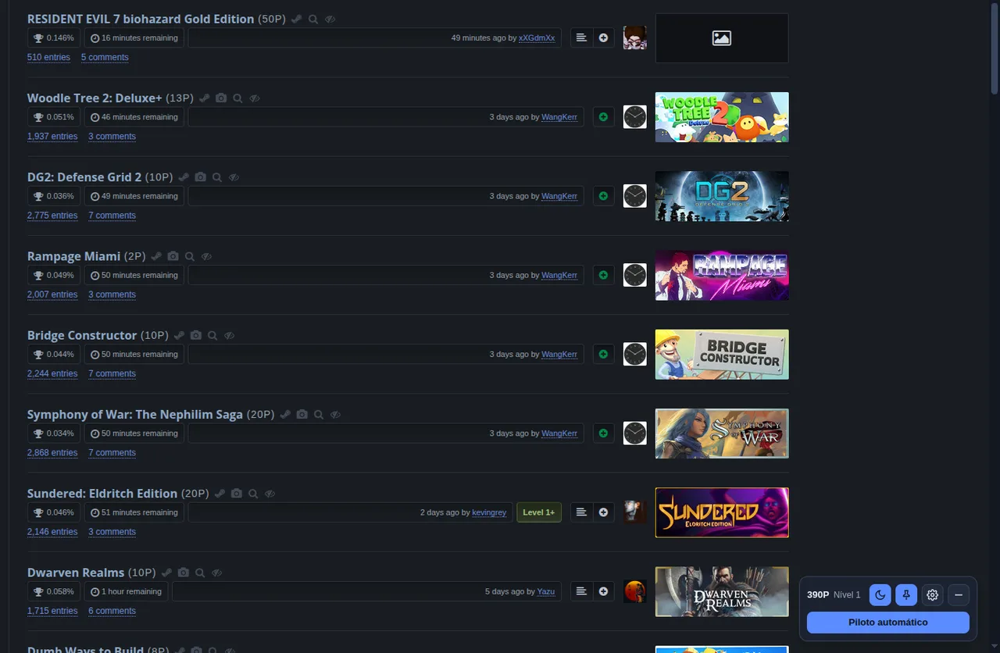
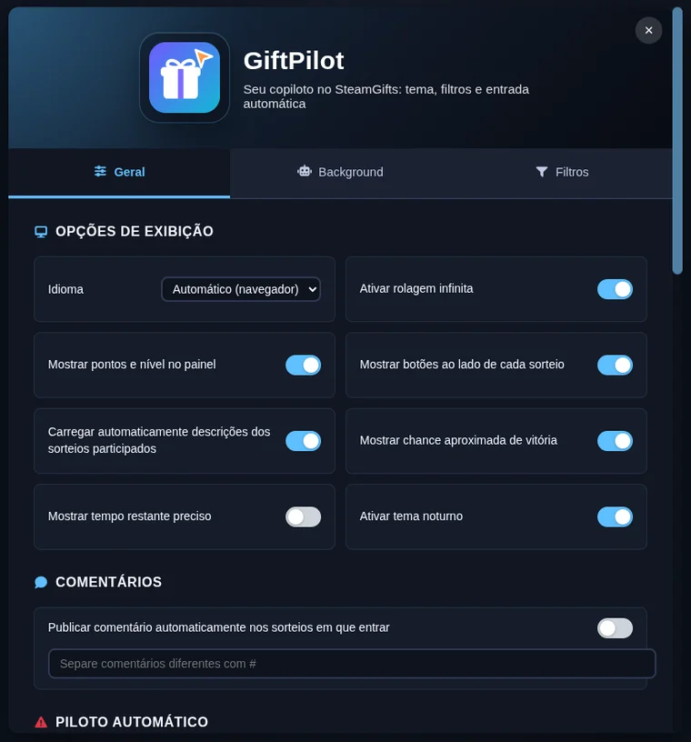

<div align="center">


# GiftPilot

**Your co-pilot on SteamGifts.** A real dark theme, filters that clean up the list, win odds on every giveaway and an autopilot with human pacing.

[](https://github.com/bernardopg/GiftPilot/releases)
[](https://github.com/bernardopg/GiftPilot/actions/workflows/ci.yml)
[](https://developer.chrome.com/docs/extensions/develop/migrate/what-is-mv3)
[](LICENSE)

[Website](https://bernardopg.github.io/GiftPilot/) ·
[Install](#install) ·
[Features](#features) ·
[Development](#development) ·
[Changelog](CHANGELOG.md) ·
[Português](docs/pt-br-documentation/README.md)



</div>

---

## Why GiftPilot

- **Discreet by design.** Everything you see comes from a panel in a closed shadow root. The page sees no extension buttons, ids or classes, and requests have the same shape as the site's own.
- **Respects your pace.** The autopilot enters one giveaway at a time, with irregular intervals, pauses to "read" required descriptions and stops as soon as points run out.
- **Pretty without breaking the site.** The dark theme is generated from the official SteamGifts stylesheet, so it covers the whole page with no white flash.
- **Zero production dependencies.** Only the extension's own JavaScript, CSS and HTML. No tracking, no analytics, no third-party servers.

> [!WARNING]
> Entering giveaways automatically is against the [SteamGifts rules](https://www.steamgifts.com/about/guidelines) and may get your account suspended. The autopilot is **off** by default and optional. Everything else (theme, filters, odds, infinite scrolling) is normal site use.

## Features

| Area                   | What it does                                                                                                                                     |
| ---------------------- | ------------------------------------------------------------------------------------------------------------------------------------------------ |
| 🌙 **Dark theme**      | Generated from the official CSS; applied before the page paints, toggled from the panel.                                                         |
| 📌 **Pinned navbar**   | Keeps the SteamGifts navigation at the top while scrolling.                                                                                      |
| 🎯 **Win odds**        | Per-giveaway estimate, projecting entries until the end.                                                                                         |
| 🧹 **Filters**         | Hide by level, cost, already entered, group, whitelist, DLC, no trading cards and games you already own.                                         |
| ♾️ **Infinite scroll** | Loads the next pages with every feature applied.                                                                                                 |
| 🛩️ **Autopilot**       | Sequential, cancellable queue; wishlist/group/region/whitelist priority; min and max cost; required descriptions handled the way a person would. |
| ⏰ **Background mode** | Every _N_ hours checks for wins, warns about accumulated points and, if you want, enters giveaways while keeping your reserved points.           |
| 🏆 **Wins**            | Notification with sound and optional key redemption on Steam.                                                                                    |
| 🌐 **Languages**       | English and Portuguese (Brazil), detected automatically.                                                                                         |

<div align="center">

</div>

## Install

GiftPilot runs on Chromium browsers (Chrome, Edge, Brave, Opera, Vivaldi) version 116 or newer.

**From a release**

1. Download `giftpilot-vX.Y.Z.zip` from the [latest release](https://github.com/bernardopg/GiftPilot/releases/latest) and extract it.
2. Open `chrome://extensions` and turn on **Developer mode**.
3. Click **Load unpacked** and pick the extracted folder.

**From source**

```bash
git clone https://github.com/bernardopg/GiftPilot.git
cd GiftPilot
npm ci
npm run build   # outputs build/extension
```

Load `build/extension` (or the repository root while developing) in `chrome://extensions`.

## Usage

1. Sign in to [SteamGifts](https://www.steamgifts.com).
2. The panel shows up in the bottom-right corner with your points and shortcuts: 🌙 theme, 📌 pinned navbar, ⚙️ settings and − minimize.
3. To use the autopilot, enable **Show Autopilot button** in the settings. The button turns into **Stop** while it runs.
4. Click the extension icon in the browser toolbar to open the settings at any time.

**Keyboard shortcuts** (outside text fields): `Alt+S` settings · `Alt+T` theme · `Alt+J` / `Alt+K` next / previous giveaway.

### Main settings

| Setting                       | Default | Notes                                              |
| ----------------------------- | ------- | -------------------------------------------------- |
| Dark theme                    | off     | Also on the 🌙 panel button.                       |
| Infinite scrolling            | on      |                                                    |
| Win odds                      | on      |                                                    |
| Autopilot button              | off     | Optional; read the warning above.                  |
| Average delay between entries | 10 s    | With random jitter and pauses.                     |
| Wishlist priority             | on      | Requires being signed in to the Steam Store.       |
| Ignore featured giveaways     | on      |                                                    |
| Background autopilot          | off     | Default page: wishlist; every 5 h.                 |
| Points to preserve            | 0       | In background mode, never spends below this value. |

## Privacy

- No data leaves your browser for project servers: there are no project servers.
- Settings are stored in `chrome.storage` (synced through your browser account).
- Permissions: `storage`, `alarms`, `notifications`, `tabs`, `scripting`, `offscreen` and `declarativeNetRequest`, plus access to `steamgifts.com` and the Steam Store. Access to Steam Community profiles is optional and only requested when needed.

## Development

Requires Node.js 22, 24 or 26 (see `.nvmrc`).

```bash
npm ci
npm run check     # ESLint + Prettier
npm test          # unit tests (node:test)
npm run verify    # metadata + i18n + tests
npm run build     # check + verify + build/extension
npm run package   # build + dist/giftpilot-vX.Y.Z.zip
npm run release   # alias of package (the release itself is created by CI)
```

To regenerate the dark theme after SteamGifts changes its CSS: save the new file to `tests/fixtures/steamgifts/site.css` and run `node scripts/build-site-dark.mjs`.

### Layout

```
manifest.json
_locales/            translated name and description
assets/              logo, icons and win sound
css/
  site/              styles injected into SteamGifts (theme, pinned navbar, widgets)
  options/           settings page
  vendor/            Font Awesome
html/                settings and offscreen document
js/
  background/        service worker: routine, notifications, request bridge
  content/           page scripts: panel, rows, scrolling, autopilot
  core/              pure shared modules (parsing, planning, i18n, timing…)
  offscreen/         HTML parsing, audio and key redemption
  options/           settings page logic
scripts/             build, packaging, checks and theme generator
tests/               tests and SteamGifts fixtures
docs/                GitHub Pages site and Portuguese documentation
```

More details in [AGENTS.md](AGENTS.md) (architecture and project rules) and in the [contributing guide](.github/CONTRIBUTING.md).

## Contributing

Issues and pull requests are welcome. Read the [contributing guide](.github/CONTRIBUTING.md) and the [code of conduct](.github/CODE_OF_CONDUCT.md). For vulnerabilities, follow the [security policy](.github/SECURITY.md).

If GiftPilot helps you, consider [sponsoring the project](https://github.com/sponsors/bernardopg).

## License

[MIT](LICENSE) © 2024-2026 Bernardo Pinto Gomes

Not affiliated with SteamGifts or Valve.
